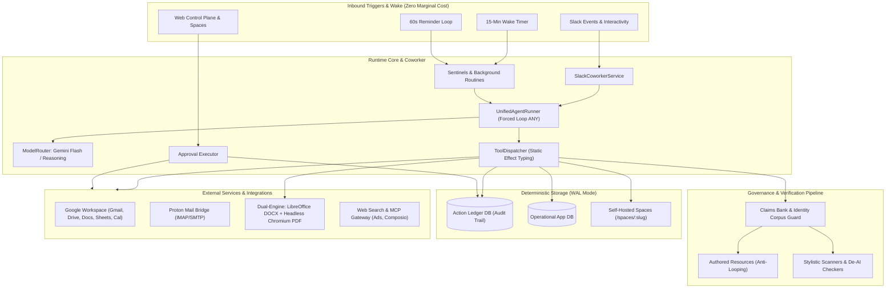

# Ellie v5

<p align="center">
  
  
  
  
  
  
  
</p>

> **Showcase status**
>
> This repository is a public architecture and implementation showcase, not a supported hosted
> service or a drop-in production deployment. It connects to external providers such as Slack,
> Google, and Gemini and starts background workers when run. Use synthetic accounts and data when
> exploring it, and do not point it at real communications or credentials without an independent
> deployment review.

> **Operating Doctrine:**  
> *"The agent owns the work. The owner owns decisions and commitments. Host code owns authority."*

---

## Executive Summary

**Ellie v5** is a single-tenant, Slack-first **AI Chief of Staff reference implementation** demonstrating executive workflows, strategic continuity, document generation, and background automation.

Unlike conventional chatbots or multi-tenant agent platforms that charge recurring credit markups for idle polling loops, Ellie runs on a **direct-API architectural foundation** designed for solo operators and high-leverage executives. Built on the core principle of **"Cheap triggers, expensive thinking,"** Ellie executes background event detection (IMAP UIDs, Gmail history checkpoints, Drive timestamps, cron alarms) in lightweight host code at zero marginal cost—invoking Google Gemini models only when an actual state change demands cognitive synthesis.

Ellie reads email, calendars, Drive files, and web sources; autonomously performs reversible background tasks; renders publication-grade DOCX and PDF documents; publishes interactive web spaces; and enforces **deterministic host code governance** over every outward communication or consequential action.

---

## Architectural Highlights



---

## Core Architectural Pillars

### 1. Deterministic Host Governance (Action Ledger)
> [!IMPORTANT]
> System prompts like *"please do not send emails without asking"* fail under prompt injection, context truncation, or conversational pressure. **Host code must maintain absolute authority.**

Native tools are statically assigned to effect classes:
* `READ`: Free of side-effects; executed concurrently in parallel (`Promise.all`).
* `LOCAL_WRITE`: Internal modifications (memory, aliases, routine definitions).
* `INTERNAL_REVERSIBLE_WRITE`: Internal actions executed without an approval card; tool-specific read-back checks run where implemented.
* `CONSEQUENTIAL`: Outward-facing actions (`gmail_send`, `proton_send`, `calendar_create`, external API writes).

When an agent attempts a `CONSEQUENTIAL` tool call, the `ToolDispatcher` intercepts the execution:
1. The tool call is **refused direct execution**.
2. The proposal is written to SQLite `action_ledger`; its state changes are recorded in the append-only `action_ledger_events` history.
3. An interactive Slack card shows the complete serialized payload as plain text. Payloads too large to review safely in Slack cannot be approved from the card and must be reviewed in the control plane.
4. Only an HMAC-verified Slack interaction from the configured owner invokes `governance/executor.ts`, enforcing allowlists, rate limits, and tool-level checks.

### 2. Forced Tool Loop (`function_calling_mode: "ANY"`)
The agent never produces conversational free-text without ground truth. Every single model turn requires invoking a declared tool. A run terminates exclusively when the model invokes a synthetic `finish` tool call carrying:
* **Explicit Execution Status**: `DONE`, `NEEDS_INPUT`, `BLOCKED`, `NOTHING_TO_REPORT`, or `CONTINUE_IN_BACKGROUND`.
* **Explicit Delivery Mode**: `SLACK_MESSAGE` (thread reply), `REACTION_ONLY` (emoji acknowledgement), or `SILENT` (routine complete with no actionable delta).
* **Budget Enforcers**: Slack runs enforce strict limits (25 rounds, ~4.5 minute timeouts). If exhausted, the model is forced into a terminal `finish` call detailing completed tasks and pending continuation tokens.

### 3. Heuristic Outbound Claims Guard
When drafting executive correspondence, cover letters, or tailored resumes, generative models tend to fabricate contact information, embellish metrics, or invent career milestones.
* **Claims Bank Guard**: Checks supported outbound message text and owner-authored document paths before staging or writing.
* **Corpus Matching**: Checks the numeric, contact-detail, link, title, and experience patterns listed in the architecture notes against configured owner sources.
* **Ungrounded Claims Rejection**: If ungrounded assertions are detected, the proposal is immediately rejected with a structured `[Document Check]` diagnostic, forcing the model to revise or cite source evidence.

These are deterministic heuristics, not a proof that generated text is true. Named-entity checking is disabled for document layouts to avoid false positives, date ranges are masked during numeric extraction, and coverage depends on which tool and source integration are configured. Review important outbound material manually.

### 4. Self-Referential Evidence Protection (Anti-Looping)
Over weeks of autonomous operation, agents reading past Drive documents or email threads frequently mistake their own earlier hypothetical drafts for verified facts.
* Tools that declare authored-resource tracking record the generated Doc or Drive file in an `authored_resources` registry.
* Reads that declare the matching resource, plus stored results, are marked **non-evidence** when Ellie authored them, reducing recursive hallucination drift.

### 5. Regularized Self-Improvement & Memory (RRSI)
Uncontrolled agent self-learning causes prompt bloat and leaks private transient data into global memory.
* **Strict Memory Budget**: Active memory injection into the system prompt is hard-capped at ~1,000 tokens.
* **Wilson-Score Utility Ranking**: Memory rules and operational lessons compete for inclusion based on proven feedback utility.
* **Leakage Critic**: An automated heuristic pass validates every memory candidate, refusing entries containing specific dates, dollar amounts, temporary email addresses, or ungeneralizable one-off details.

### 6. Dual-Engine Document Rendering
Ellie features a dual-engine document synthesis pipeline sharing a unified verification gate:
1. **Linear / ATS-Grade Engine (`document_render`)**:
   - Takes a structured semantic block schema (headings, roles, bullet points, key-value blocks).
   - Generates OOXML `.docx` files via Node `docx` with embedded Open Font License typography (*Merriweather* and *Google Sans Text*).
   - Converts to PDF via headless LibreOffice on the host.
   - Verifies exact page counts (e.g., resumes must be exactly 2 pages; cover letters <= 1 page) and verifies ATS text reading order via Poppler (`pdftotext`).
   - Runs deterministic typographic auto-fitting across subtle margin and line-spacing presets before engaging multimodal visual review.
2. **Visual One-Pager & Infographic Engine (`visual_document_render`)**:
   - Compiles HTML5, modern CSS Grid/Flexbox, and inline SVG iconography into executive one-pagers, split-card pitch sheets, and workflow infographics.
   - Uses an iterative A4 height-solver targeting 92%–100% density without spillover.
   - Exports pixel-perfect PDFs via headless Chromium.

### 7. Interactive Spaces (`/spaces/:slug`)
Instead of overwhelming Slack threads with unreadable walls of text, Ellie publishes persistent HTML5 micro-applications, dashboards, and research viewers at `/spaces/:slug`. The server sandboxes the page and links it from chat; authored pages may still reference optional remote images or styles, subject to CSP.

### 8. Multi-Tier Model Routing & Context Caching
Ellie dynamically routes requests across specialized operational tiers:
* **SENTINEL** (`Gemini Flash`, temperature 0.0, low thinking): High-speed triage of incoming emails, reminder triggers, and layout checks.
* **ROUTINE** (`Gemini Flash`, temperature 0.2, medium thinking): Scheduled background synthesis, daily briefings, and folder sweeps.
* **INTERACTIVE** (`Gemini Flash`, temperature 0.3, medium thinking): Default Slack coworker threads.
* **ESCALATION** (`Gemini Flash`, temperature 0.3, high thinking): Automatically triggered after two consecutive tool errors.
* **ANALYSIS / EVALUATOR** (`Gemini Reasoning`, temperature 0.0–0.2, max thinking): Complex job scoring, deep multi-doc synthesis, and pre-publish routine verification.

**Static Prefix Caching**: The static prompt prefix is registered with an explicit Gemini context cache when the configured model and API support it. The implementation falls back to uncached requests when cache creation fails; cache hit rates depend on the workload.

---

## Tool Ecosystem Catalog

Every native tool is strictly typed with Zod schemas, assigned an effect class, and guarded by host code before invocation:

| Subsystem | Highlighted Capabilities |
| :--- | :--- |
| **Google Workspace** | `gmail_search`, `gmail_read`, `gmail_draft`, `gmail_send` (consequential), `sheets_read`, `sheets_append`, `sheets_update`, `docs_read`, `docs_create`, `docs_append`, `drive_search`, `drive_read_file`, `calendar_list`, `calendar_create` (consequential). |
| **Secure Mail Bridge** | `proton_search`, `proton_list_unread`, `proton_read`, `proton_draft`, `proton_send` (consequential SMTP staging via Proton Mail Bridge). |
| **Verification & Claims** | `owner_sources_read` (batch-read identity dossier and claims), `owner_text_check` (pre-flight claims and humanization validator). |
| **Document Rendering** | `document_render` (linear DOCX/PDF via LibreOffice), `visual_document_render` (visual one-pagers/infographics via Chromium). |
| **Memory, State & Spaces** | `memory_save`, `memory_list_facts`, `memory_record_candidate`, `memory_promote_candidate`, `reminder_set`, `result_read`, `sheet_query`, `waiting_track`, `waiting_list`, `waiting_resolve`, `project_state_read`, `project_state_update`, `space_publish`, `space_list`. |
| **Skills & Research** | `skills_list`, `skill_read`, `skill_edit`, `job_evaluate`, `delegate_subtask`, `image_generate`. |
| **Web & MCP Gateway** | `web_search`, `web_read_page`, `apify_linkedin_profile`, `apify_linkedin_posts`, plus Model Context Protocol integrations for advertising and LinkedIn data. |
| **Dynamic Composio SaaS** | `composio_search_tools`, `composio_install_tool`, `composio_setup_tool`, `composio_execute_tool`, `composio_list_installed`. Consequential SaaS tools inherit Action Ledger approvals. |
| **Diagnostics & Host Ops** | `repo_list_and_search`, `repo_read_file`, `trace_inspect_recent`, `vps_inspect`. |
| **Command & Control** | `routine_manage`, `reminder_manage`, `nudge_settings_manage`, `memory_manage`, `queue_manage`, `workspace_alias_manage`, `sentinel_manage`, `cost_and_budget_manage`. |

---

## Repository Structure

```
ellie-v5/
├── assets/fonts/               # Bundled OFL typography (Google Sans Text, Merriweather)
├── deploy/
│   ├── push.sh                 # Staged deployment script with health-check rollback
│   └── vps.sh                  # Host bootstrap and cutover script for systemd units
├── docs/
│   ├── INVENTORY_PUBLIC.md     # Comprehensive public architecture & governance specification
│   ├── ELLIE_DESIGN.md         # Current design principles, tradeoffs, and source map
│   ├── HOW_ELLIE_WORKS.md      # Plain-English product walkthrough
│   ├── PLAN.md                 # Curated roadmap, milestones, and known limitations
│   └── Ellie_v5_Architecture_Specification.docx
├── android/                    # Experimental native Android companion (Jetpack Compose)
│   └── app/src/main/java/com/ellie/app/
├── skills/                     # Domain-specific executive skills & Polish language humanizers
│   ├── humanization/           # AI tell-stripping scanner and prose naturalizer
│   ├── humanizer-pl/           # Polish voice & stylistic norms
│   └── poprawna-polszczyzna/   # Contemporary Polish orthography and business registers
├── src/
│   ├── config/                 # Environment validation, model constants, allowlists
│   ├── documents/              # Dual-engine document synthesis (DOCX, HTML/SVG, PDF, fonts)
│   ├── governance/             # Action Ledger, Claims Bank Guard, Executor, Result Store
│   ├── integrations/           # Slack Coworker, Google Workspace, Proton Bridge, Composio, MCP
│   ├── storage/                # SQLite repositories, including learning and memory ledgers
│   ├── runtime/                # UnifiedAgentRunner, prompt builder, model router, cache manager
│   ├── scheduler/              # Sentinels (Gmail, Proton, Cal), cron routines, nudge gate
│   ├── tools/                  # Statically typed native tool definitions
│   ├── web/                    # Express control plane, REST endpoints, spaces hosting
│   ├── index.ts                # Application entry point
│   ├── wake.ts                 # 15-minute background wake timer script
│   └── test/                   # Offline unit and integration tests
├── package.json                # Modern ESM Node.js >=22.13.0 dependencies
├── tsconfig.json               # TypeScript 5.8+ ES2022 configuration
└── RUNBOOK.md                  # Optional deployment, security, and diagnostic examples
```

---

## Quickstart & Local Setup

### Prerequisites
* **Node.js**: `>=22.13.0` (uses native `node:sqlite` in WAL mode and native fetch)
* **LibreOffice & Poppler** *(optional for local document rendering)*: `soffice`, `pdftoppm`, `pdfinfo`
* **Google Gemini API Key**
* **Slack App Credentials**: Bot Token (`xoxb-...`) and Signing Secret

### 1. Installation
```bash
git clone https://github.com/marcinpilarczyk/ellie-5-showcase.git
cd ellie-5-showcase
npm ci
```

### 2. Configuration
Copy the template and populate credentials:
```bash
cp .env.example .env
```
Key configuration parameters:
* `GEMINI_API_KEY`: Google Gemini API key.
* `SLACK_BOT_TOKEN`, `SLACK_SIGNING_SECRET`: Slack connectivity.
* `SLACK_OWNER_USER_ID`: Your Slack member ID (events from other users are ignored).
* `ELLIE_DATA_DIR`: SQLite storage path (defaults to `~/.local/share/ellie`).
* `ELLIE_CONTROL_PLANE_TOKEN`: Secret token required for web control plane access.
* `ELLIE_ENABLE_JINA_FALLBACK`: Optional external-reader fallback, disabled by default.

### 3. Environment Diagnosis
Run the built-in diagnostic doctor to verify models, directories, and provider connectivity:
```bash
npm run doctor
```

### 4. Running the Test Suite
The repository includes an offline unit and integration test suite using mocked providers and realistic sandboxes. `npm test` builds the TypeScript output first:
```bash
npm test
```
To run tests directly against TypeScript source with `tsx`:
```bash
npm run test:ts
```

### 5. Running the Server
```bash
npm run build
npm start
```

---

## Optional Deployment Notes

The deployment material is included as an engineering reference, not as a supported showcase runtime. A real deployment needs its own security, privacy, backup, and provider-access review.

* **Public Webhook Endpoint**: Exposed via Tailscale Funnel to `/api/slack/events` and Google OAuth redirects.
* **Control Plane & Spaces**: Accessible on a private Tailscale IP (e.g. port `10000`) without public exposure, authenticated by socket origin.
* **Staged Deployment with Health-Check Rollback**:
  Deployments run from the repository root via `deploy/push.sh`:
  ```bash
  bash deploy/push.sh
  ```
  The deployment script uploads committed `HEAD` to a staging directory, builds and validates it, swaps it into place, then checks the service health. A failed restart or health check restores `~/ellie.prev` when a previous install exists.

For complete operational procedures, backup restoration, and service monitoring, consult **[RUNBOOK.md](RUNBOOK.md)**.

---

## Technical Documentation & References

* **[How Ellie Works: A Plain-English Guide](docs/HOW_ELLIE_WORKS.md)**: A comprehensive non-technical walkthrough of Ellie's role, daily workflows, safety mechanisms, and capabilities.
* **[Public Architecture & Governance Specification](docs/INVENTORY_PUBLIC.md)**: Exhaustive breakdown of system topology, model routing parameters, and tool catalogs.
* **[Ellie Design Notes](docs/ELLIE_DESIGN.md)**: Current architecture principles, evidence boundaries, document generation, and key tradeoffs.
* **[Example Runbook](RUNBOOK.md)**: Local setup, optional systemd deployment, security boundaries, and diagnostics.
* **[Showcase Roadmap](docs/PLAN.md)**: Curated milestones, improvement areas, and known limitations.

---

## License

This project is licensed under the [MIT License](LICENSE).
