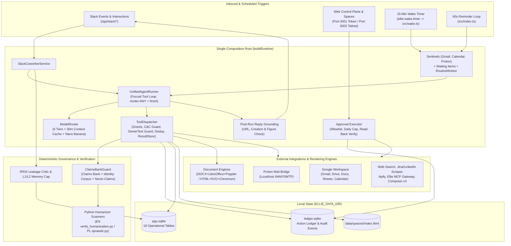
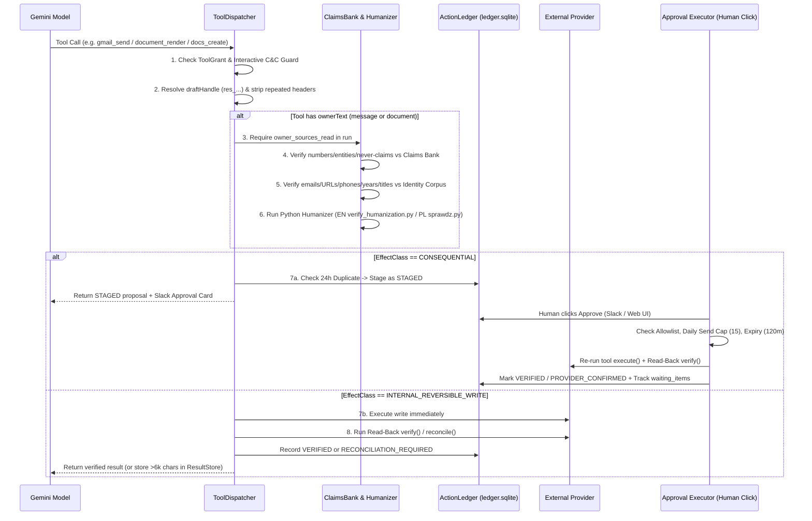

# Ellie v5: Complete Architecture, Features & Capabilities Inventory

> **Operating Doctrine**: *"Ellie owns the work. The owner owns decisions and commitments. Host code owns authority."* ([docs/ELLIE_DESIGN.md](ELLIE_DESIGN.md), [src/agent/prefix-builder.ts](../src/agent/prefix-builder.ts))

**Ellie v5** (`v5.0.0`, clean-slate rebuild initiated Oct 14, 2026) is a private, single-tenant, Slack-first AI Chief of Staff built for a single owner (`ELLIE_OWNER_NAME` / `ELLIE_OWNER_FULL_NAME`). It combines multi-tier Gemini reasoning and vision with deterministic host-code governance (Principles P1–P13), an append-only human-in-the-loop Action Ledger, zero-hallucination outbound text/document verification, dual-engine formatted document generation, proactive background sentinels, scheduled routines, and a self-hosted Web Control Plane & Spaces gallery.

---

## 1. System Architecture & Runtime Topology

### 1.1 High-Level Architecture Diagram

### 1.2 Tech Stack & Runtime Requirements

| Layer | Technology / Requirement | Source Reference |
| :--- | :--- | :--- |
| **Language & Runtime** | TypeScript `^5.8.2` (`ES2022`, `NodeNext` ESM), Node.js `>=22.13.0` | `package.json`, `tsconfig.json` |
| **Database** | Node built-in `node:sqlite` (`DatabaseSync`) in `WAL` mode (`app.sqlite` + `ledger.sqlite`) | `src/storage/database.ts` |
| **AI SDK** | `@google/genai` (`^2.27.0`) — Gemini Flash, Gemini Reasoning (Argon/Pro), Nano Banana Image, Google Search Grounding, Context Caching | `src/models/model-router.ts` |
| **HTTP & Web** | `express` (`^4.21.2`) + Zero-build single-file dark-mode SPA | `src/http/app.ts`, `src/web/index.html` |
| **Document Rendering** | `docx` (`9.7.2`) + `jszip` (`3.10.1`), bundled OFL `Merriweather` & `Google Sans Text` TTFs, headless LibreOffice (`soffice`), Poppler (`pdfinfo`, `pdftotext`, `pdftoppm`), headless Chromium/Chrome/Edge | `src/documents/render-docx.ts`, `src/documents/pdf.ts`, `src/documents/render-html-pdf.ts` |
| **Mail & Workspace** | `googleapis` (`^144.0.0`), `imapflow` (`^1.0.171`), `mailparser` (`^3.7.2`), `nodemailer` (`^6.10.0`) | `src/integrations/google/client.ts`, `src/integrations/proton/client.ts` |
| **Prose Verification** | `python3` executing deterministic EN (`verify_humanization.py`) and PL (`sprawdz.py`) scanners | `src/governance/humanizer-scanner.ts` |

### 1.3 Entry Points & Operational Processes

1. **Interactive Server (`npm start` / `ellie.service` — `src/index.ts`)**:
   - **Fail-Closed Startup (P11)**: Refuses to start in production if `ELLIE_CONTROL_PLANE_TOKEN`, `GEMINI_API_KEY`, `SLACK_SIGNING_SECRET`, or `SLACK_OWNER_USER_ID` is unset.
   - **Dual Loopback Listeners**:
     - `127.0.0.1:$PORT` (default `3001`): Public webhook receiver (via Tailscale Funnel `:8443` for `/api/health`, `/api/slack/*`, `/api/integrations/google/callback`) and token-authenticated Web Control Plane.
     - `127.0.0.1:$ELLIE_PRIVATE_PORT` (default `3002`): Added to `app.locals.trustedPorts` for token-free access over the private tailnet (`tailscale serve` `:10000`), verified strictly by local socket port rather than HTTP headers (`src/http/auth-middleware.ts`).
   - **Reminder Poller**: Runs `runtime.reminderDispatcher.dispatchDueReminders()` every 60 seconds.

2. **15-Minute Wake Worker (`npm run wake` / `ellie-wake.service` + `ellie-wake.timer` — `src/wake.ts`)**:
   - Enforces a 14-minute hard timeout (`WAKE_HARD_TIMEOUT_MS`) and executes 8 sequential background steps:
     1. **Gmail Sentinel** (`runtime.gmailSentinel.runCheck()`)
     2. **Calendar Sentinel** (`runtime.calendarSentinel.runCheck()`)
     3. **Proton Sentinel** (`runtime.protonSentinel.runCheck()`)
     4. **Scheduled Reminders** (`runtime.reminderDispatcher.dispatchDueReminders()`)
     5. **Overdue Waiting Items** (`processOverdueWaitingItems()` — auto-stages follow-up emails in the Action Ledger and posts Slack approval cards)
     6. **Storage Maintenance** (prunes `tool_results` older than 14 days and stale `preference_candidates` older than 30 days)
     7. **Owner Doc Inventory Refresh** (`runtime.ownerInventory.refreshIfDue()` — runs once daily after `03:00` local time)
     8. **Due Cron Routines** (`runtime.routineWorker.runDueRoutines(new Date(), 1)` — executes at most 1 due routine per wake cycle, skipped if `<2 min` remain before the 14m hard timeout).

3. **Pre-Flight Doctor (`npm run doctor` — `src/scripts/doctor.ts`)**:
   - Verifies required/optional/obsolete env vars, ensures `ELLIE_DATA_DIR` is not on a cloud-synced drive in production, checks SQLite migrations, validates Gemini model IDs via `client.models.get`, pings Slack `auth.test`, tests Google Workspace `getGmailProfile()`, verifies MCP Gateway `tools/list`, runs an end-to-end `DOCX -> LibreOffice PDF -> pdfinfo -> pdftotext` test, and probes Proton Bridge TCP (`127.0.0.1:1143`).

4. **Google OAuth Token CLI (`npm run google-token:export` / `import` — `src/scripts/google-token.ts`)**:
   - Exports and imports the `google_main` OAuth row (`0o600` file permissions) without printing secrets to stdout.

---

## 2. Core Subsystems & Governance Pipeline

### 2.1 AI Model Router & Context Caching (`src/models/model-router.ts`)

| Tier | Backing Model | Thinking Level | Temp | Primary Use Cases |
| :--- | :--- | :--- | :--- | :--- |
| **`SENTINEL`** | `GEMINI_FLASH_MODEL` (`gemini-3.8-flash`) | `low` | `0.0` | Email triage, in-thread card edits, correction extraction, PDF visual layout check |
| **`ROUTINE`** | `GEMINI_FLASH_MODEL` | `medium` | `0.2` | Scheduled cron routines, background continuations, `delegate_subtask` default |
| **`INTERACTIVE`** | `GEMINI_FLASH_MODEL` | `medium` (env override) | `0.3` | Default Slack DM and thread conversations |
| **`ESCALATION`** | `GEMINI_FLASH_MODEL` | `high` | `0.3` | Auto-escalated by `UnifiedAgentRunner` after 2 consecutive rounds with tool errors |
| **`ANALYSIS`** | `GEMINI_REASONING_MODEL` (falls back to Flash) | `high` | `0.2` | `job_evaluate`, routines specifying `reasoning`/`pro`/`argon`, `/argon` Slack threads |
| **`EVALUATOR`** | `GEMINI_REASONING_MODEL` (falls back to Flash) | `high` | `0.0` | Post-routine hard-constraint evaluator pass |

- **Sticky Thread Reasoning**: Typing `/argon` or natural-language cues (`"use argon"`, `"use the reasoning model"`, `"switch to pro"`) switches the thread to `ANALYSIS` for all subsequent messages until cancelled with `"use flash"` / `"flash only"`.
- **Explicit Context Caching**: `prefixCacheName()` hashes `[model, systemInstruction, tools, toolConfig]` with SHA-256 and creates an explicit Gemini cache (`ttl: '1800s'`). `SlackCoworkerService` calls `warmPrefixCache()` fire-and-forget immediately upon receiving a Slack message.

### 2.2 Two-Layer Prompt Split & Unified Agent Runner (`src/agent/prefix-builder.ts`, `src/agent/runner.ts`)

- **Byte-Stable Static Prefix (`buildStaticSystemPrefix`)**: 9 sections (`Core Identity & Operating Doctrine`, `Authority & Governance Model`, `Anti-Hallucination & Verification Contract`, `Communication & Chief-of-Staff Voice`, `Outward Communication & Claims Bank`, `Memory & Learning Discipline`, `Result Store & Handle Discipline`, `Available Skills Index`, `Self-Diagnosis & Introspection`). Zero timestamps or dynamic variables so the Gemini prefix cache stays valid across runs.
- **Dynamic Runtime Context (`buildRuntimeContextBlock`)**: Injected into the user message turn with local time (`Europe/Warsaw`), trigger metadata, `batchId`, active memory facts (capped at $\le 1,000$ tokens / 4,000 chars), workspace aliases, nightly `owner_doc_inventory` map, cached owner config rules, and thread carryover handles.
- **Forced Tool-Calling Contract**:
  - Runs with `functionCallingConfig: { mode: 'ANY' }`. Plain-text completion is impossible; the model must invoke the synthetic `finish` tool with `status` (`DONE`, `NEEDS_INPUT`, `BLOCKED`, `NOTHING_TO_REPORT`, `CONTINUE_IN_BACKGROUND`) and `deliveryMode` (`SLACK_MESSAGE`, `REACTION_ONLY`, `SILENT`).
  - **Parallel Read Execution**: Multiple `READ` tool calls in a single turn execute concurrently via `Promise.all`, followed sequentially by any write/stage calls.
  - **Repetition & Budget Guards**: Identical consecutive tool calls or exhausted wall-clock/round budgets (`~4.5m` / 25 rounds interactive; `8m` / 20 rounds routine) restrict `allowedFunctionNames` to `['finish']`.
  - **Autonomous Background Continuation**: If a Slack run ends with `CONTINUE_IN_BACKGROUND` and `nextStepPrompt`, `SlackCoworkerService` automatically chains up to 2 background continuation runs in the same thread.

### 2.3 Deterministic Governance Pipeline (`src/governance/*`)

1. **Owner Text Guard (`src/governance/claims-bank.ts`, `src/governance/humanizer-scanner.ts`)**:
   - Applies to `gmail_draft`, `gmail_send`, `proton_draft`, `proton_send`, `docs_create`, `docs_append`, `document_render`, and `visual_document_render`.
   - Requires `owner_sources_read` to have been called first.
   - **Claims Check**: Blocks ungrounded quantitative figures (percentages, currencies, multipliers, headcount/metrics), ungrounded named-entity + outcome verbs in messages, and any rule matching `[X]` in the Claims Bank Doc or `never-claims.json`.
   - **Identity Check**: Blocks any email, URL/domain, phone number, `"N+ years"` phrase, or `"Senior/Lead/VP..."` title not verbatim in `OwnerSources` or run evidence (and requires owner-named emails/URLs to appear specifically in `OwnerSources`).
   - **Humanizer Gate**: Runs `verify_humanization.py` (English) or `sprawdz.py` (Polish) on prose $\ge 120$ chars; blocks on Tier A banned phrases, Tier B clusters, or Polish RJP 2026 `BŁĄD` orthography/punctuation errors.
2. **Self-Referential Evidence Protection (`src/storage/authored-resources.ts`)**:
   - Every Doc created by Ellie is logged in `authored_resources`. Subsequent `docs_read` or `drive_read_file` calls on that Doc are marked `not_evidence: true` so Ellie's own prior generations can never be used to ground future factual claims.
3. **Post-Run Reply Grounding (`src/governance/reply-grounding.ts`)**:
   - Inspects every Slack message before delivery: strips unverified `docs.google.com`/`drive.google.com` links (`[link withheld: not verified]`), flags unverified file-creation claims, discloses any `FAILED` ledger actions, and appends a grounding note if hard quantitative figures in the reply are absent from run evidence.

---

## 3. Complete Tool Inventory (74 Tools + Dynamic Composio Tools)

All tools below are **fully implemented** in `src/tools/*` and wired in `src/runtime/build-runtime.ts`.

### 3.1 Google Workspace Tools (14 Tools — `src/tools/google-tools.ts`)

| Tool Name | Effect Class | Guards & Verification | Description |
| :--- | :--- | :--- | :--- |
| `gmail_search` | `READ` | ResultStore (`>6k` chars) | Search Gmail threads by query (`maxResults` default 10). |
| `gmail_read` | `READ` | Compacted via `compactGmailThread` | Fetch full messages and plain bodies for a Gmail `threadId`. |
| `gmail_draft` | `INTERNAL_REVERSIBLE_WRITE` | `ownerText (message)`, `getGmailDraft` read-back | Create a Gmail draft (`to`, `subject`, `body`, `threadId`). |
| `gmail_send` | `CONSEQUENTIAL` | `ownerText (message)`, 24h dedup, Approval Card, `getGmailMessage` verify | Stage an outbound Gmail message in `action_ledger` for owner approval. |
| `sheets_read` | `READ` | Alias resolution, ResultStore | Read a range from a Google Sheet (`spreadsheetId` or alias, `range`). |
| `sheets_append` | `INTERNAL_REVERSIBLE_WRITE` | Header-mapped `prepareSheetAppend` + `reconcileSheetAppend` | Append rows (`values` 2D array or `records` objects mapped to sheet headers). |
| `sheets_update` | `INTERNAL_REVERSIBLE_WRITE` | Cell-by-cell read-back verification | Update existing cells in place (`spreadsheetId` or alias, `range`, `values`). |
| `docs_read` | `READ` | `readsResource` (`not_evidence` if Ellie-authored) | Read full text (all tabs + table cells) of a Google Doc. |
| `docs_create` | `INTERNAL_REVERSIBLE_WRITE` | `ownerText (document)`, `writesResource`, `readDoc` verify | Create a plain Google Doc and record its ID in `authored_resources`. |
| `docs_append` | `INTERNAL_REVERSIBLE_WRITE` | `ownerText (document)`, substring read-back verify | Append text to an existing Google Doc (`documentId` or alias). |
| `drive_search` | `READ` | ResultStore | Search Google Drive files (`query`, `maxResults` default 10). |
| `drive_read_file` | `READ` | `readsResource` (`not_evidence` if Ellie-authored) | Universal reader for Google Docs, PDFs (`pdftotext`), `.docx` (XML), and text/CSV/JSON. |
| `calendar_list` | `READ` | Compacted via `compactCalendarEvents` | List Google Calendar events between `timeMin` and `timeMax`. |
| `calendar_create` | `CONSEQUENTIAL` | 24h dedup, Approval Card, `getCalendarEvent` verify | Stage a new Google Calendar event (`summary`, `startTime`, `endTime`, `attendees`). |

### 3.2 Proton Mail Bridge Tools (5 Tools — `src/tools/proton-tools.ts`)
*Registered when `PROTON_USERNAME` and `PROTON_BRIDGE_PASSWORD` are set (`PROTON_ENABLED !== 'false'`).*

| Tool Name | Effect Class | Guards & Verification | Description |
| :--- | :--- | :--- | :--- |
| `proton_search` | `READ` | ResultStore | Search Proton Mail messages (`query`, `folder` default `'INBOX'`). |
| `proton_list_unread` | `READ` | ResultStore | List unread messages in Proton Mail (`limit` default 10). |
| `proton_read` | `READ` | ResultStore | Read full message body and headers by `uid` and `folder`. |
| `proton_draft` | `INTERNAL_REVERSIBLE_WRITE` | `ownerText (message)`, IMAP UID verify | Save a draft message into Proton Mail `Drafts` via IMAP APPEND. |
| `proton_send` | `CONSEQUENTIAL` | `ownerText (message)`, 24h dedup, Approval Card | Stage a Proton Mail outbound email; sends via SMTP and appends to `Sent` upon approval. |

### 3.3 Owner Sources & Pre-Write Verification Tools (2 Tools)

| Tool Name | Effect Class | Source File | Description |
| :--- | :--- | :--- | :--- |
| `owner_sources_read` | `READ` (`providesOwnerSources`) | `src/tools/owner-source-tools.ts` | Reads canonical Google Docs from the `ELLIE_CONFIG_DOC_ID` root folder, `Projects/` subfolders, `ELLIE_RECORD_DOC_ID`, and `ELLIE_CLAIMS_BANK_DOC_ID` (cached by `modifiedTime` in `owner_doc_cache`). |
| `owner_text_check` | `READ` (`keepsDraft`, `notEvidence`) | `src/tools/owner-text-check-tool.ts` | Runs the full `reviewOwnerText` check (Claims Bank + Identity + EN/PL Humanizer) on plain `text` or document `blocks` and returns a `draftHandle` (`res_...`) for zero-copy reuse in write tools. |

### 3.4 Dual-Engine Document Rendering Tools (2 Tools — `src/tools/document-tools.ts`)

| Tool Name | Effect Class | Engine & Verification Pipeline | Description |
| :--- | :--- | :--- | :--- |
| `document_render` | `INTERNAL_REVERSIBLE_WRITE` | `ownerText (document)`, `docx` + embedded OFL `Merriweather`/`Google Sans Text` TTFs -> LibreOffice `.pdf` -> Auto-fit (`compact-1..3`, `spacious-1..2`) -> Page count & page-2 fill check -> `pdftotext` ATS reading-order check -> Gemini Flash multimodal `visualCheck` -> Drive upload + read-back | Renders formatted linear documents (`resume` [exact 2 pages], `cover_letter` [$\le 1$ page], `memo`, `brief`, `report`) and uploads both `.docx` and `.pdf` to Drive. |
| `visual_document_render` | `INTERNAL_REVERSIBLE_WRITE` | `ownerText (document)`, HTML5 + CSS Grid/Flexbox + 24 inline Feather/Lucide SVGs -> Deterministic 1-page A4 auto-fit solver (`92%–100%` fill) -> Headless Chromium/Edge PDF -> Gemini Flash `visualCheck` -> Drive upload + read-back | Renders designed 1-page visual documents (`one_pager`, `pitch_sheet`, `infographic`) across 3 palettes (`executive-editorial`, `warm-editorial`, `slate-modern`) using `banner_header`, `step_flow`, `split_grid`, `status_table`, `benefit_card`, `icon_strip`, and `cta_footer`. |

### 3.5 Memory, Follow-Through, Project State, Spaces & Result Store Tools (15 Tools)

| Tool Name | Effect Class | Source File | Description |
| :--- | :--- | :--- | :--- |
| `memory_save` | `LOCAL_WRITE` | `src/tools/memory-tools.ts` | Save an explicit owner-stated fact or preference (`screenCandidateLeakage` guarded). |
| `memory_list_facts` | `READ` | `src/tools/memory-tools.ts` | Search or list active executive memory facts. |
| `memory_record_candidate` | `LOCAL_WRITE` | `src/tools/memory-tools.ts` | Stage a tentative learned pattern in `preference_candidates` + `rrsi_edit_ledger`. |
| `memory_list_candidates` | `READ` (`notEvidence`) | `src/tools/memory-tools.ts` | List pending preference candidates filtered by `minOccurrences`. |
| `memory_promote_candidate` | `LOCAL_WRITE` | `src/tools/memory-tools.ts` | Promote a corroborated candidate to an active `memory_facts` entry. |
| `reminder_set` | `LOCAL_WRITE` | `src/tools/memory-tools.ts` | Schedule a timed Slack reminder (`scheduled_reminders`). |
| `result_read` | `READ` | `src/tools/result-tools.ts` | Page through a stored `res_...` handle by character `offset` and `maxChars`. |
| `sheet_query` | `READ` | `src/tools/result-tools.ts` | Filter and project rows/columns from a stored sheet or table handle. |
| `waiting_track` | `LOCAL_WRITE` | `src/tools/waiting-tools.ts` | Track an outbound open loop or owed reply (`counterparty`, `subject`, `due_at`). |
| `waiting_list` | `READ` | `src/tools/waiting-tools.ts` | Query `waiting_items` by status (`active`, `open`, `nudged`, `resolved`), counterparty, or deadline. |
| `waiting_resolve` | `LOCAL_WRITE` | `src/tools/waiting-tools.ts` | Mark a `waiting_items` entry as `resolved` with a note. |
| `project_state_read` | `READ` | `src/tools/project-state-tools.ts` | Read and parse the 8 canonical sections of `/Projects/<Project>/PROJECT_STATE`. |
| `project_state_update` | `INTERNAL_REVERSIBLE_WRITE` | `src/tools/project-state-tools.ts` | Create or selectively update canonical sections of a project's `PROJECT_STATE` Doc. |
| `space_publish` | `INTERNAL_REVERSIBLE_WRITE` | `src/tools/space-tools.ts` | Publish or update a self-hosted interactive HTML page at `/spaces/<slug>`. |
| `space_list` | `READ` | `src/tools/space-tools.ts` | List published Spaces by `status`, `category`, or `search`. |

### 3.6 Skills, Job Evaluation, Subtasks & Image Generation Tools (6 Tools)

| Tool Name | Effect Class | Source File | Description |
| :--- | :--- | :--- | :--- |
| `skills_list` | `READ` | `src/tools/skill-tools.ts` | List all domain skills in `skills/`. |
| `skill_read` | `READ` | `src/tools/skill-tools.ts` | Read a `skills/<skillId>/SKILL.md` instruction file. |
| `skill_edit` | `INTERNAL_REVERSIBLE_WRITE` | `src/tools/skill-tools.ts` | Create or update a `skills/<skillId>/SKILL.md` file (path-traversal guarded + verified). |
| `job_evaluate` | `READ` | `src/tools/job-evaluate-tool.ts` | Evaluates a job posting on the `ANALYSIS` (Reasoning) tier against owner career sources; outputs structured 0–100 score, `STRONG_APPLY`/`APPLY`/`BORDERLINE`/`SKIP`, 5 sub-scores, flags, and tailoring angles. |
| `delegate_subtask` | `READ` | `src/tools/subtask-tool.ts` | Spawns an isolated child `UnifiedAgentRunner` (max 6 rounds, 2m budget, `READ`-only tools, max depth 1) and returns only the distilled answer. |
| `image_generate` | `INTERNAL_REVERSIBLE_WRITE` | `src/tools/image-tools.ts` | Generates or edits images via `gemini-3.1-flash-image` (Google Nano Banana), strips PNG/JPEG EXIF/metadata chunks, uploads to the Slack thread, and archives to Google Drive (`Images/`). |

### 3.7 Web Search, Social Scraping & MCP Gateway Tools (21 Tools)

| Tool Name | Effect Class | Condition / Guard | Description |
| :--- | :--- | :--- | :--- |
| `web_search` | `READ` | Always active | Grounded Google Search via Gemini `{ googleSearch: {} }` (`src/tools/web-tools.ts`). |
| `web_read_page` | `READ` | SSRF guard (`isSafePublicUrl`) | Multi-fallback URL reader (direct HTML + LinkedIn guest job API + Jina Reader `r.jina.ai` fallback) (`src/tools/web-tools.ts`). |
| `apify_linkedin_profile` | `READ` | `APIFY_API_TOKEN`, daily cap (25) | Scrapes LinkedIn profiles via Apify (`src/tools/social-tools.ts`). |
| `apify_linkedin_posts` | `READ` | `APIFY_API_TOKEN`, daily cap (25) | Scrapes LinkedIn posts via Apify (`src/tools/social-tools.ts`). |
| `mcp_elliegateway_get_gateway_status` | `READ` | `ELLIE_MCP_GATEWAY_URL` + SHA-256 baseline pin | Gateway health & status (`src/governance/reviewed-baseline.ts`). |
| `mcp_elliegateway_list_integrations` | `READ` | `ELLIE_MCP_GATEWAY_URL` + SHA-256 baseline pin | Lists connected MCP Gateway integrations. |
| `mcp_elliegateway_amazon_ads_*` (5 tools) | `READ` | `ELLIE_MCP_GATEWAY_URL` + SHA-256 baseline pin | `list_profiles`, `get_campaigns`, `get_ad_groups`, `get_keywords`, `get_performance_report`. |
| `mcp_elliegateway_meta_ads_*` (5 tools) | `READ` | `ELLIE_MCP_GATEWAY_URL` + SHA-256 baseline pin | `get_ad_accounts`, `get_campaigns`, `get_ad_sets`, `get_ads`, `get_insights`. |
| `mcp_elliegateway_linkedin_*` (5 tools) | `READ` | `ELLIE_MCP_GATEWAY_URL` + SHA-256 baseline pin | LinkedIn DMA Member Data Portability: `get_member_profile`, `get_Changelog`, `get_member_snapshot`, `query_member_snapshot`, `list_snapshot_domains`. |

### 3.8 Composio Dynamic Tool Discovery & Execution (5 Static Tools + Dynamic `composio_<slug>` Tools — `src/tools/composio-tools.ts`)
*Registered when `COMPOSIO_API_KEY` is set.*

| Tool Name | Effect Class | Description |
| :--- | :--- | :--- |
| `composio_search_tools` | `READ` | Searches Composio v3 catalog by query/toolkit, annotating auth requirements and write/consequential risk. |
| `composio_install_tool` | `CONSEQUENTIAL` | Stages a tool installation proposal (`slug`, `reason`, `pendingTask`) in `action_ledger`. Upon human approval, installs into `composio_tools`, registers `composio_<slug>` in `ToolDispatcher`, and either posts an OAuth `redirectUrl` or **auto-resumes `pendingTask` in the Slack thread** (`src/integrations/slack/coworker.ts`). |
| `composio_setup_tool` | `INTERNAL_REVERSIBLE_WRITE` | Checks OAuth connection status or generates a fresh OAuth `redirectUrl` for an installed Composio tool. |
| `composio_execute_tool` | `READ` | Executes an installed read-only Composio tool (blocks write/consequential slugs). |
| `composio_list_installed` | `READ` | Lists all installed Composio tools persisted in `app.sqlite`. |
| `composio_<slug>` (Dynamic) | `READ` or `CONSEQUENTIAL` | Registered per installed tool; write/consequential slugs are automatically gated through `action_ledger` approval cards. |

### 3.9 Self-Diagnosis & VPS Inspection Tools (4 Tools)

| Tool Name | Effect Class | Source File | Description |
| :--- | :--- | :--- | :--- |
| `repo_list_and_search` | `READ` (`notEvidence`) | `src/tools/self-diagnosis.ts` | Lists/searches files in `src/`, `skills/`, and `package.json` (hard-blocks `.env*`, `private/*`, `*.sqlite*`). |
| `repo_read_file` | `READ` (`notEvidence`) | `src/tools/self-diagnosis.ts` | Reads line ranges (up to 250 lines) of allowed repository files. |
| `trace_inspect_recent` | `READ` (`notEvidence`) | `src/tools/self-diagnosis.ts` | Inspects recent `run_traces` (full error details + 300-char tool digests and handles). |
| `vps_inspect` | `READ` (`notEvidence`) | `src/tools/vps-inspect.ts` | Read-only Linux systemd/journal/resource inspection (`service_status`, `service_logs`, `timers`, `processes`, `resources`) for allowlisted units with secret redaction. |

### 3.10 Interactive Command & Control Tools (8 Tools — Interactive Slack Only)
*Hard-blocked in background/routine runs by `COMMAND_AND_CONTROL_TOOL_NAMES` (`src/types/tool.ts`, `src/governance/dispatcher.ts`).*

| Tool Name | Supported Actions | Source File |
| :--- | :--- | :--- |
| `routine_manage` | `list`, `get`, `create`, `enable`, `disable`, `update_schedule`, `update_instructions`, `delete`, `run_now` | `src/tools/routine-tools.ts` |
| `reminder_manage` | `list`, `create`, `reschedule`, `cancel`, `delete` | `src/tools/reminder-tools.ts` |
| `nudge_settings_manage` | `get_status`, `snooze`, `unsnooze`, `set_quiet_hours`, `set_daily_cap`, `deliver_held_digest` | `src/tools/nudge-tools.ts` |
| `memory_manage` | `list`, `ledger` (RRSI audit log), `save`, `forget`, `promote_candidate`, `dismiss_candidate` | `src/tools/memory-tools.ts` |
| `queue_manage` | `list`, `inspect`, `drop`, `drop_all` *(cannot approve consequential actions)* | `src/tools/queue-manage-tools.ts` |
| `workspace_alias_manage` | `list`, `set`, `remove` | `src/tools/workspace-alias-tools.ts` |
| `sentinel_manage` | `status`, `enable`, `disable`, `list_rules`, `add_vip_rule`, `add_ignore_rule`, `remove_rule` | `src/tools/sentinel-manage-tools.ts` |
| `cost_and_budget_manage` | `today`, `this_week`, `by_source`, `set_soft_daily_cap` | `src/tools/cost-manage-tools.ts` |

---

## 4. Proactive Sentinels, Routines, Memory & Continuity

### 4.1 Sentinels & Nudge Gate (`src/scheduler/*`)
- **Gmail Sentinel (`src/scheduler/sentinels/gmail-sentinel.ts`)**: Tracks unread primary inbox messages, applies `vip`/`ignore` sender rules, auto-resolves open `waiting_items` when a counterparty replies (`resolveMatchingWaitingItems`), runs `triageIncomingEmails` (`SENTINEL` tier), and posts actionable Slack notifications with a 1-click **Draft Reply** button (`sentinel_draft_reply`).
- **Proton Sentinel (`src/scheduler/sentinels/proton-sentinel.ts`)**: Mirrors the Gmail sentinel workflow over localhost Proton Bridge IMAP (`proton_list_unread`), including `waiting_items` auto-resolution and **Draft Reply** buttons (`sentinel_proton_draft_reply`).
- **Calendar Sentinel (`src/scheduler/sentinels/calendar-sentinel.ts`)**: Checks upcoming events within the next 45 minutes and alerts on imminent meetings or scheduling overlaps.
- **Nudge Gate (`src/scheduler/nudge-gate.ts`)**: Enforces quiet hours (default `22:00–08:00`), daily nudge cap (default `8`), snooze windows, and 24-hour deduplication (`nudge_log`). Held nudges can be flushed on demand as a single digest.

### 4.2 Cron Routines & Evaluator Pass (`src/scheduler/routine-worker.ts`)
- **Pre-Flight Drive Check**: In `src/runtime/build-runtime.ts`, routines with `allow_silence=1` that inspect Drive folders check the folder's `modifiedTime` first and skip the LLM run (`SILENT`) if nothing changed since `last_run_at`.
- **Claim Locking**: Uses atomic `running_since` timestamps in SQLite with a 30-minute stale-lock recovery window.
- **Post-Routine Evaluator Pass**: When a routine defines `hard_constraints`, `RoutineWorker` runs a second verification pass on the `EVALUATOR` tier (`reasoningModel`, `temperature: 0.0`) checking the draft output against the constraints and actual tool evidence before delivering to Slack.

### 4.3 RRSI Self-Improvement & Memory Regularization (`src/storage/memory-repo.ts`, `src/agent/correction-extractor.ts`)
- **In-Thread Card Revisions & Diff-to-Lesson Extraction**: When the owner replies in a thread to edit a staged Slack card, `SlackCoworkerService` updates the staged action in place and invokes `extractCorrectionLesson` to infer a generalizable preference candidate.
- **Deterministic Leakage Critic (`screenCandidateLeakage`)**: Rejects any candidate containing specific email addresses, URLs, phone numbers, dates, currency amounts, or long recipient-specific proper nouns so one-off facts never pollute global style memory.
- **RRSI Edit Ledger & $L_1$/$L_2$ Regularization**: Every candidate/rule mutation is logged in `rrsi_edit_ledger`. `MemoryRepository` enforces a 4,000-character (~1,000-token) $L_2$ cap on active memory injected into the prompt, ranking facts by Wilson-interval / Laplace-smoothed utility score (`delta_score`) and auto-superseding low-utility entries when over budget.

---

## 5. Database Schema Inventory (`ELLIE_DATA_DIR`)

### 5.1 `ledger.sqlite` (Schema v1 — `src/storage/schema.ts`)
| Table | Purpose |
| :--- | :--- |
| `action_ledger` | All staged and executed actions (`STAGED`, `APPROVED`, `EXECUTING`, `EXECUTED`, `VERIFIED`, `PROVIDER_CONFIRMED`, `RECONCILIATION_REQUIRED`, `DENIED`, `FAILED`, `EXPIRED`). |
| `action_ledger_events` | Immutable append-only audit log of every state transition, actor, and timestamp. |

### 5.2 `app.sqlite` (Schema v12 — `src/storage/schema.ts`)
| Table | Migration | Purpose |
| :--- | :--- | :--- |
| `tool_results` | v1, v5 | Stored tool outputs (`res_...`), row counts, and `not_evidence` taint flags. |
| `run_traces` | v1, v2, v7 | Full execution telemetry, token/cache breakdowns, tool call lists, and `delivered_text`. |
| `integrations` | v1 | OAuth token storage (`google_main`). |
| `memory_facts` | v1 | Active, superseded, and forgotten executive memory rules/facts. |
| `preference_candidates` | v1 | Staged learned patterns awaiting corroboration (`occurrences >= 2`) or promotion. |
| `routines` | v1, v6, v11 | Scheduled cron routines, constraints, grants, and last-run status/locks. |
| `thread_carryover` | v1, v4 | Per-Slack-thread evidence history and result handles across turns. |
| `sentinel_state` | v1 | Checkpoints (`historyId`, `uidNext`, `seen_ids`) and enabled state for sentinels. |
| `sentinel_sender_rules` | v1 | `vip` and `ignore` sender patterns per sentinel. |
| `system_settings` | v1 | Quiet hours, daily nudge cap, snooze timestamp, and soft daily USD spend cap. |
| `workspace_aliases` | v1 | Friendly alias names mapped to Google Drive/Doc/Sheet IDs. |
| `api_usage` | v1 | Per-call token & USD spend telemetry across Gemini Flash, Reasoning, and Apify. |
| `scheduled_reminders` | v1 | Timed Slack reminders. |
| `owner_config_cache` | v1 | Cached copy of the owner's `ELLIE_CONFIG_DOC_ID` Google Doc. |
| `nudge_log` | v1 | Audit & deduplication log of `SENT`, `HELD`, `DROPPED`, and `DIGESTED` nudges. |
| `owner_doc_inventory` | v3 | Nightly Flash-summarized map of the owner's Google Docs (`title`, `folder`, `purpose`). |
| `authored_resources` | v5 | Registry of Doc/file IDs created by Ellie (prevents self-referential grounding). |
| `waiting_items` | v8 | Open-loop tracker (`open`, `nudged`, `resolved`) for outbound follow-through. |
| `spaces` | v9 | Metadata for self-hosted HTML Spaces served at `/spaces/:slug`. |
| `owner_doc_cache` | v10 | `modified_time`-keyed full text cache of owner Google Docs. |
| `rrsi_edit_ledger` | v11 | Regularized Recursive Self-Improvement ledger tracking candidate acceptance and utility scores. |
| `composio_tools` | v12 | Installed dynamic Composio tools and OAuth connection metadata. |

---

## 6. Built-In Domain Skills (`skills/*`)

| Skill ID | Files & Scripts | Capabilities |
| :--- | :--- | :--- |
| **`humanization`** | `skills/humanization/SKILL.md`, `scripts/verify_humanization.py`, `references/*` | English Humanization Codex v4.3: strips AI tropes (Tier A hard blocks, Tier B clusters, structural symmetry, Copula avoidance) and verifies burstiness ($CV \ge 0.45$). |
| **`humanizer-pl`** | `skills/humanizer-pl/SKILL.md`, `scripts/sprawdz.py`, `references/norma.md`, `references/wzorce-ai.md` | Unified Polish skill combining the 2026 Rada Języka Polskiego (RJP) orthographic reform with 33 Polish AI-tell detectors and deterministic Python verification. |
| **`humanizer`** | `skills/humanizer/SKILL.md` | 630-line comprehensive Polish AI-tell encyclopedia (v3.0.0-pl) with legal/official register exemptions. |
| **`poprawna-polszczyzna`** | `skills/poprawna-polszczyzna/SKILL.md` | Detailed Polish grammar, punctuation, typography, and RJP 2026 orthography rules. |

---

## 7. Web Control Plane & HTTP API (`src/http/*`, `src/web/index.html`)

### 7.1 HTTP Endpoints (`src/http/app.ts`)
- **Public / Webhook Routes**:
  - `GET /api/health` — Returns `{ status: 'ok', service: 'ellie-v5' }`.
  - `POST /api/slack/events` & `POST /api/slack/interactions` — Slack HMAC-SHA256 verified webhook endpoints (`src/http/routes/slack.ts`).
  - `GET /api/integrations/google/callback` (and `/api/auth/google/callback`) — OAuth2 callback storing tokens in `app.sqlite`.
- **Authenticated Control Plane Routes** (Token on `:3001` or trusted socket `:3002`):
  - `GET /api/queue`, `POST /api/queue/:id/approve`, `POST /api/queue/:id/deny`, `POST /api/queue/batch/:batchId/approve` (`src/http/routes/queue.ts`).
  - `GET /api/ops/traces`, `GET /api/ops/costs`, `GET /api/ops/routines`, `POST /api/ops/routines/:id/toggle`, `POST /api/ops/routines/:id/run`, `GET /api/ops/sentinels`, `GET /api/ops/waiting` (`src/http/routes/ops.ts`).
  - `GET /api/spaces`, `POST /api/spaces/:slug/archive`, `GET /spaces/:slug` (`src/http/routes/spaces.ts`).

### 7.2 Web Control Plane Views (`src/web/index.html`)
1. **Approvals (`/`)**: Live queue of staged consequential actions with **Approve & Execute** and **Drop** buttons.
2. **Spaces (`/spaces`)**: Searchable, filterable gallery of Ellie-published HTML dashboards, radars, trackers, and reports.
3. **Routines (`/routines`)**: Cron schedule table with live `Running since` badges, **Enable/Disable** toggles, and **Run now** triggers.
4. **Runs & Traces (`/runs`)**: Glass-box run inspector showing status, duration, token/cache usage, exact `Delivered to Slack` text, and numbered tool calls with result handles.
5. **Usage & Costs (`/costs`)**: 7-day token and USD cost breakdown across Gemini Flash and Reasoning models.
6. **Project Docs (`/docs`)**: Reference view of `/EllieOS/Projects/<Project>/PROJECT_STATE` conventions and P5/P8 verification rules.
7. **Settings (`/settings`)**: Live status of Model Router tiers, Google OAuth connection link, Slack Bot, Proton Bridge, and governance guards.

---

## 8. Implementation Status & Audit Notes

- **Fully Implemented**: All 74 static tools (59 core/conditional + 15 additional MCP/Composio/management tools), dual SQLite schemas, both document rendering engines (DOCX+LibreOffice and HTML/SVG+Chromium), Nano Banana image generation/editing, inbound Slack vision, proactive sentinels, cron routines with evaluator pass, RRSI memory regularization, and the Web Control Plane are fully implemented and covered by **41 test suites** (`src/test/*.test.ts`).
- **Audio / Voice**: Not implemented (no TTS/STT or real-time voice streaming in v5).
- **Per-Run Tool Grant Alias Nuance (`src/integrations/slack/coworker.ts`)**:
  - A few constant arrays in `coworker.ts` list legacy tool aliases (e.g., `gmail_get_thread` instead of `gmail_read`, `composio_search_free_tools` instead of `composio_search_tools`).
  - Most tools remain granted via the fallback loop in `resolveInteractiveSlackGrant()`, except `composio_search_tools` and `composio_list_installed` (which are filtered by the `composio_` prefix check unless `COMPOSIO_TOOL_NAMES` is updated to match their exact registered names).
