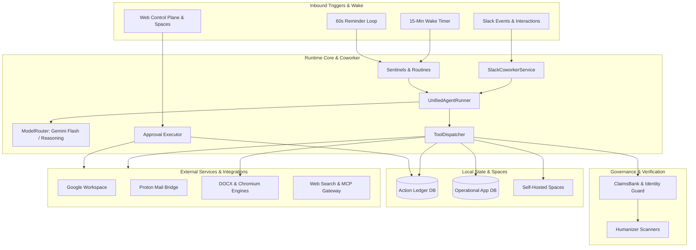

# Ellie v5: architecture, features and governance specification
*(Public / external engineering reference)*

> Operating doctrine: "The agent owns the work. The owner owns decisions and commitments. Host code owns authority."

---

## 0. Executive preface: context note for AI employee platforms

### Background and motivation
This architecture specification documents Ellie v5, a private, single-tenant, Slack-first AI Chief of Staff. The system was designed and built following production experience with commercial AI coworker platforms, specifically Viktor.com (where the author is an active participant in the Viktor Implementation Specialist program).

Viktor is great and excels for mid-size and enterprise companies, where pooled team budgets absorb usage-based consumption naturally. That is why it is an ideal platform to pitch and implement for corporate clients. Viktor pioneered several interaction patterns that heavily inspired Ellie:
1. The coworker experience: interacting inside Slack channels and threads with a natural conversational voice, responsiveness, and solid context retention instead of acting like a temporary chatbot.
2. Silence as a valid output: recognizing that in scheduled monitoring, saying nothing when nothing changed is the hallmark of an executive assistant.
3. Interactive spaces: publishing persistent, visual HTML micro-applications and dashboards instead of dumping walls of formatted text into chat.

### The freelancer dilemma and real-world friction
For a freelancer or solo operator, usage-based credit tiers become an obstacle to running an always-on, 24/7 personal chief of staff:
* Background vigilance anxiety: running continuous background watchers (inbox monitoring, calendar overlap checks, folder sweeps, open loop tracking) constantly drains monthly credit allotments. Having to throttle or pause 10 out of 11 routines just to save credits defeats the core value of an autonomous coworker.
* Polling versus thinking: in multi-tenant managed setups, over 90% of credits end up consumed by idle polling loops and conversational ping-pongs, not deep reasoning.

Viktor's workflow was too good to drop, but running it continuously as an independent operator required a setup anchored in direct-API pricing and deterministic host-code execution:

1. Cheap triggers, expensive thinking:
   Trigger detection runs in lightweight host code (inspecting IMAP UID sequences, Gmail historyId checkpoints, Google Drive modification timestamps, or receiving webhooks) at zero marginal cost. Gemini models run only when an actual state change needs intelligence, reducing background costs to near zero while keeping sub-minute responsiveness.

2. Deterministic governance versus prompt pleading:
   System prompts like "do not send emails without permission" fail under prompt injection, context truncation, or subtle conversational pressure. Host code keeps absolute authority. Native tools belong to static effect classes (READ, LOCAL_WRITE, INTERNAL_REVERSIBLE_WRITE, CONSEQUENTIAL). Consequential tools (sending emails, staging external payments, creating public calendar entries) cannot execute directly. The dispatcher intercepts the call, logs it in an append-only SQLite ledger, and renders a cryptographic Slack approval card. Only an explicit human click triggers execution.

3. Outbound claims banking:
   Language models drafting executive correspondence or resumes tend to embellish metrics, hallucinate phone numbers, or invent career milestones. An automated claims bank guard intercepts outbound drafts and documents. It scans text against a verified identity corpus and numerical repository, blocking ungrounded quantitative claims and unauthorized contact details before text reaches the approval queue.

4. Self-referential evidence protection:
   Over time, an agent reading past documents or email threads begins treating its own prior drafts as ground-truth evidence, compounding hallucinations over successive cycles. Every resource generated by the agent is logged in an authored resources registry. When reading Google Docs, Drive files, or stored results, any artifact authored by the agent is marked as non-evidence, cutting off self-referential hallucination loops.

5. Memory regularization:
   Unchecked agent self-learning causes prompt context explosion and captures transient details (such as specific email addresses, one-off dates, private recipient notes) into global long-term memory. A regularized self-improvement engine enforces a strict budget cap of about 1,000 tokens on active injected memory, scores lessons using Wilson-score utility rankings, and runs an automated leakage critic that rejects candidates containing specific dates, currency amounts, emails, or recipient-specific proper nouns.

---

## 1. System architecture and runtime topology

### 1.1 High-level architecture diagram

### 1.2 Technology stack

| Layer | Implementation | Role |
| :--- | :--- | :--- |
| Runtime | TypeScript 5.8+ (ES2022, NodeNext ESM), Node.js >=22.13.0 | Core application runtime |
| Database | Built-in node:sqlite (DatabaseSync) in WAL mode | Operational state (app.sqlite) and audit ledger (ledger.sqlite) |
| Foundation models | Google genai SDK (Gemini 3.8 Flash, Gemini Reasoning, Image Models) | Multi-tier reasoning, vision, and explicit context caching |
| Web service | Express with a single-file responsive dark-mode interface | Control plane, REST endpoints, and Spaces hosting |
| Document generation | docx, headless LibreOffice, Poppler utilities, and headless Chromium | Dual-engine linear and visual document rendering |
| Tabular sandbox | In-memory node:sqlite (DatabaseSync) | Isolated SQL querying of attached user spreadsheets |
| External tools | Model Context Protocol gateway and Composio connector | Integration with advertising, CRM, and cloud toolchains |

---

## 2. Core subsystems and governance pipeline

### 2.1 Multi-tier model routing and context caching

| Tier | Default model | Thinking budget | Temperature | Target workloads |
| :--- | :--- | :--- | :--- | :--- |
| SENTINEL | Gemini Flash | low | 0.0 | Email triage, thread card edits, correction extraction, layout checks |
| ROUTINE | Gemini Flash | medium | 0.2 | Scheduled cron routines, background continuations, subtask delegation |
| INTERACTIVE | Gemini Flash | medium | 0.3 | Default Slack conversations and threads |
| ESCALATION | Gemini Flash | high | 0.3 | Auto-escalated upon repeated tool execution errors |
| ANALYSIS | Gemini Reasoning | high | 0.2 | Deep synthesis, complex evaluations, threads flagged with /argon |
| EVALUATOR | Gemini Reasoning | high | 0.0 | Post-routine constraint verification before posting deliverables |

Static prefix caching:
The static prompt prefix (doctrine, governance, tool discipline) is hashed with SHA-256 and registered with an explicit 1,800-second Gemini context cache. The coworker service warms this cache asynchronously upon receiving incoming Slack events.

Token efficiency:
Low media resolution is applied for document and PDF visual layout checks. A zero thinking budget is configured on fast internal extraction tasks such as lesson extraction and text slimming. Redundant Slack block markup and Markdown noise are stripped before prompt assembly.

### 2.2 Forced tool loop and execution discipline

The agent runs with function calling mode set to ANY. Plain-text model completion is disabled. The model must invoke a tool on every turn, terminating through a synthetic finish tool call with explicit status (DONE, NEEDS_INPUT, BLOCKED, NOTHING_TO_REPORT, CONTINUE_IN_BACKGROUND) and deliveryMode (SLACK_MESSAGE, REACTION_ONLY, SILENT).

Multiple read tool calls in a single turn execute concurrently through Promise.all, followed sequentially by write or staging actions. Long-running interactive tasks can yield CONTINUE_IN_BACKGROUND with a prompt, allowing the coworker service to chain background execution rounds without blocking Slack response deadlines.

### 2.3 Deterministic governance and action ledger

Host code maintains absolute authority:
1. ToolDispatcher validates the active grant and interactive safety guards.
2. Draft handles are resolved and verified against the Claims Bank and Identity Corpus.
3. If the tool is classified as CONSEQUENTIAL, the proposal is staged in the Action Ledger and rendered as a Slack approval card.
4. Only a verified human click invokes the execution handler.
5. If the tool is classified as INTERNAL_REVERSIBLE_WRITE, the operation executes immediately and runs an automated read-back verification pass.

---

## 3. Tool catalog inventory

All 74 native tools are statically typed, assigned an effect class, and guarded by host code before invocation.

### 3.1 Google Workspace tools (14 tools)
* gmail_search and gmail_read: read-only message and thread discovery with payload decoders.
* gmail_draft: non-consequential draft creation with read-back verification.
* gmail_send: consequential outbound email staging requiring human Slack approval.
* sheets_read, sheets_append, sheets_update: header-mapped reading, row appending, and cell-by-cell verified updates.
* docs_read, docs_create, docs_append: full document reading and verified authoring logged in authored resources.
* drive_search, drive_read_file: drive search and universal reading (extracts text from Docs, PDFs, Word docx, CSV, JSON).
* calendar_list, calendar_create: calendar inspection and staged consequential event creation.

### 3.2 Secure mail bridge tools (5 tools)
* proton_search, proton_list_unread, proton_read: localhost IMAP message querying and body retrieval.
* proton_draft: IMAP append draft composition.
* proton_send: consequential SMTP email staging with deduplication and approval card checks.

### 3.3 Verification and claims tools (2 tools)
* owner_sources_read: batch loader for canonical identity documents, project guidelines, and the verified claims bank.
* owner_text_check: pre-flight check evaluating plain text or document blocks against the Claims Bank, Identity Corpus, and stylistic humanization scanners.

### 3.4 Dual-engine document rendering tools (2 tools)
* document_render: linear formatted document generator (resumes, cover letters, memos, briefs, reports). Generates docx with embedded Open Font License typography, runs headless LibreOffice conversion to PDF, performs page auto-fitting, validates ATS reading order, and archives to Drive.
* visual_document_render: visual one-page document generator (one pagers, pitch sheets, infographics). Renders HTML5 and CSS Grid layouts with embedded SVG icons, runs an A4 height solver targeting 92% to 100% density, and converts through headless Chromium.

### 3.5 Memory, state, spaces and spreadsheets (15 tools)
* memory_save, memory_list_facts: explicit executive memory management.
* memory_record_candidate, memory_list_candidates, memory_promote_candidate: candidate learning pipeline.
* reminder_set: natural language scheduled Slack reminder creation.
* result_read: character-offset paging through large stored result handles.
* sheet_query: in-memory SQLite sandbox executing read-only SQL (SELECT and WITH queries) against attached XLSX, CSV, or TSV workbooks.
* waiting_track, waiting_list, waiting_resolve: outbound follow-through tracking so no open loop is forgotten.
* project_state_read, project_state_update: canonical project status tracker managing objectives, blockers, and milestones.
* space_publish, space_list: publishing and listing interactive self-hosted web micro-apps served at /spaces/:slug.

### 3.6 Skills, job evaluation, subtasks and visuals (6 tools)
* skills_list, skill_read, skill_edit: on-the-fly inspection and authoring of domain skill files.
* job_evaluate: specialized evaluation engine executing multi-criteria role scoring on the reasoning model against verified candidate dossiers.
* delegate_subtask: spawns an isolated child agent runner to distill complex research without context pollution.
* image_generate: image generation and iterative photo manipulation using Gemini Image models with automatic EXIF metadata stripping.

### 3.7 Web intelligence and gateway integrations (21 tools)
* web_search: Google Search grounding through native tool configuration.
* web_read_page: multi-fallback web reader with SSRF address validation.
* apify_linkedin_profile, apify_linkedin_posts: structured profile and post scraping with daily quota caps.
* mcp_elliegateway tools: Model Context Protocol gateway integrations (Amazon Ads reporting, Meta Ads reporting, and LinkedIn DMA data portability) pinned against SHA-256 schema baselines.

### 3.8 Dynamic Composio integration (5 tools plus dynamic slugs)
* composio_search_tools, composio_install_tool, composio_setup_tool, composio_execute_tool, composio_list_installed: dynamic discovery, authorization checking, and staging of third-party SaaS tools. Consequential actions automatically inherit Action Ledger approval requirements.

### 3.9 Self-diagnosis and infrastructure inspection (4 tools)
* repo_list_and_search, repo_read_file: code exploration and self-inspection blocking secrets, environment files, and databases.
* trace_inspect_recent: glass-box execution inspection of recent run traces, errors, and tool outputs.
* vps_inspect: sandboxed Linux systemd and journalctl resource reader with automated secret token redaction.

### 3.10 Interactive command and control tools (8 tools)
These tools are restricted to interactive Slack sessions and blocked in background routines:
* routine_manage: management of automated cron schedules and prompts.
* reminder_manage: inspection and rescheduling of active reminders.
* nudge_settings_manage: configuration of quiet hours, snooze windows, and daily proactive notification caps.
* memory_manage: review and maintenance of learned executive rules.
* queue_manage: live inspection and dropping of staged Action Ledger proposals.
* workspace_alias_manage: setting friendly alias pointers for Drive files and sheets.
* sentinel_manage: configuration of VIP sender rules and monitoring states.
* cost_and_budget_manage: telemetry inspection of daily and weekly token consumption and USD spend.

## 4. Proactive sentinels and autonomous operations

### 4.1 Sentinels and nudge gate

Gmail and Proton sentinels watch incoming correspondence around the clock. When a counterparty replies to an outstanding thread, open waiting loops resolve automatically. Inbound triage runs on the fast sentinel tier and posts Slack cards with one-click reply drafts.

A calendar sentinel checks upcoming schedules within a rolling 45-minute window, raising alerts only for imminent commitments or double bookings.

A configurable nudge gate enforces quiet hours, daily notification limits, snooze durations, and 24-hour deduplication so background alertness never degrades into notification noise.

### 4.2 Cron routines and dual-pass evaluator

Background routines that monitor external folders or trackers check resource modification timestamps before doing any work. When nothing changed, the run finishes silently without spending model tokens.

When a routine has hard factual constraints, a second evaluator pass checks the draft against tool evidence using the reasoning model before anything posts to Slack.

---

## 5. Web control plane and interface

A single-page control plane runs alongside the agent runtime under token authentication.

The approvals screen (at `/`) lists staged consequential actions with diff previews, approval buttons, and drop controls. A spaces gallery (at `/spaces`) lets users browse and search agent-published dashboards and micro-apps. The routines screen manages schedules and manual run triggers, while the runs tab provides glass-box telemetry for prompt timing, token counts, cache hit rates, and delivered text. Additional views report token costs, project documentation, and integration health checks.

---

## 6. Implementation status and roadmap

### Current production state (v5.0.0)

The core agent, deterministic governance pipeline, dual-engine document rendering (DOCX and visual HTML/SVG PDFs), and all 74 native tools are in production, backed by 44 test suites with 390 passing unit and integration tests.

### Roadmap and active development (TBD)

Mobile operations and real-time voice are currently in development. This track includes a native Android companion app (Jetpack Compose) for on-the-go approvals and space viewing, alongside bidirectional Gemini Live voice streaming over WebSockets and ambient meeting note synthesis.
